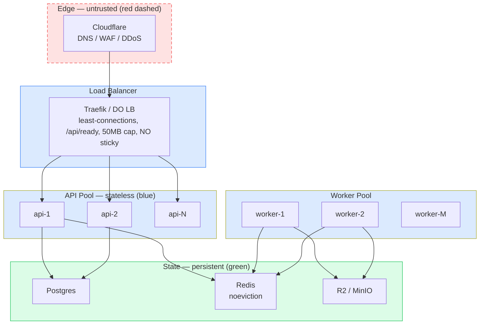

# Document Compression Pipeline

Stateless API nodes + separate worker pool + Postgres + Redis (BullMQ) + S3/R2 storage. Built for load balancing from day one.

> **Three explicit changes from previous versions:** Postgres replaces SQLite (shared DB across LB nodes); Redis + BullMQ replaces the in-process SQLite queue (shared rate limits + fan-out); API and Worker are separate processes from the same image (stateless API never parses).

---

## Quickstart (T1 — single host, production-shaped)

```bash
# Universal trigger (Linux / Mac / Windows via WSL / Git Bash / PowerShell):
node setup.js

# Or manual control if you prefer:
cp .env.example .env        # set ACME_EMAIL, PUBLIC_HOST, MSAL/PayHere IDs
docker compose up --build -d
docker compose exec api node backend/src/db/migrate.js
```

> Scripts: [`scripts/init-env.sh`](scripts/init-env.sh) (random secrets) · [`setup.sh`](setup.sh) (full run) · [`plan/one-time-setup-plan.md`](plan/one-time-setup-plan.md)

Verify load balancing actually distributes (required before T2):

```bash
docker compose up -d --scale api=2
for i in $(seq 1 6); do curl -sk https://localhost/api/health | jq -r .instance; done
# must alternate between two container IDs
```

| URL | What |
|---|---|
| `https://localhost` | Frontend (Cloudflare Pages or nginx) |
| `https://localhost/api/ready` | Readiness — DB + Redis + storage |
| `https://localhost/api/health` | Liveness — shallow |
| `https://localhost/api/billing/notify` | PayHere webhook (**no auth**, signature-only) |
| `http://127.0.0.1:8081` | Traefik dashboard (localhost only) |
| `http://127.0.0.1:9333` | SeaweedFS master UI (localhost only) |

---

## Architecture (6-level hierarchy)

See `diagrams/` for Mermaid + DOT versions.

- **L0** — System context: User / Admin → Pipeline → Entra / Modal / PayHere
- **L1** — Containers / LB: Cloudflare → Traefik (least-connections, `/api/ready`, no sticky) → api-1…N + worker-1…M + scheduler (singleton) + Postgres + Redis + R2/MinIO
- **L2** — Backend internals: Auth middleware (stateless JWT) / Routes / Validators / Quota (atomic DB) / Queue producer || Worker: Queue consumer / Extractors / Structure / Chunker / Assets / LLM Adapter / Verify / Retention
- **L3** — Pipeline sequence: upload → quota → stream to storage → enqueue → extract → chunk → model → verify (retry 2×) → fallback if missing → assemble → write JSON → status (`done` or `needs_review`; both consume 1 quota unit)
- **L4** — Deployment tiers: T1 (1 droplet) → T2 (LB + 2 API + managed DB/Redis + R2) → T3 (autoscales on queue depth + RPS) → T4 (ECS/K8s). **T1→T2 is config-only** because Postgres/Redis/BullMQ were there from day one.
- **L5** — Data lifecycle & trust boundaries (B1–B4): uploads 7-day TTL; JSON indefinite; image bytes never in JSON; per-user prefix isolation; rejected uploads deleted immediately; scratch always wiped.

### Diagram files (render with Mermaid v10)

| File | Level | Parent | What it shows |
|---|---|---|---|
| [`L0-context.mmd`](diagrams/L0-context.mmd) | L0 | root | System context: users, pipeline, Entra/Modal/PayHere |
| [`L1-containers.mmd`](diagrams/L1-containers.mmd) | L1 | L0 › Pipeline | LB (Traefik, least-connections), api pool × N, worker pool, scheduler (singleton), Postgres, Redis, R2/MinIO |
| [`L2-backend.mmd`](diagrams/L2-backend.mmd) | L2 | L1 › api / worker | Auth, routes, validators, atomic quota, adapters / extract / structure / chunk / LLM / verify / retention |
| [`L3-pipeline.mmd`](diagrams/L3-pipeline.mmd) | L3 | L2 › worker | Sequence: upload → quota → stream → enqueue → extract → chunk → model → verify (retry 2×) → fallback → assemble → write |
| [`L4-deployment-tiers.mmd`](diagrams/L4-deployment-tiers.mmd) | L4 | L1 › deployment | T1→T2→T3→T4 with promotion triggers (config-only T1→T2) |
| [`L5-data-lifecycle.mmd`](diagrams/L5-data-lifecycle.mmd) | L5 | L2 › storage | Trust boundaries B1–B4; 7-day upload / indefinite JSON / no image bytes |

> Full breadcrumbs, color rules, and validation checklist: [`diagrams/README.md`](diagrams/README.md). Every level references its parent explicitly; L1 shows ≥2 API replicas + LB with health checks.



---

### Reset / Cleanup Commands

| Action | Command | Warning |
|---|---|---|
| Stop all containers | `docker compose down` | Keeps data volumes (`pgdata`, `redisdata`, `seaweedfs_data`) |
| Remove DB container only | `docker rm -f postgres` | `pgdata` survives; DB stops |
| Wipe all data (destructive) | `docker compose down -v` | Deletes `pgdata` / `redisdata` / `seaweedfs_data` — only if you intend to retry from scratch |
| Rebuild images only | `docker compose build --no-cache` | Uses current `.env`; no data loss |
| Full reset + rebuild | `docker rm -f postgres && docker compose up --build -d` | Postgres restarts; old `api`/`worker` may need `docker compose restart` |
| Verify before removing | `docker ps` | Confirm container name; never `rm` by guess |

> Note: Option C (R2 / no SeaweedFS) means `seaweedfs_data` no longer used; `docker compose down -v` only affects remaining volumes (`pgdata`, `redisdata`).

---

## Scaling rules (hard)

| Signal | Scale target | Never scale together |
|---|---|---|
| Request rate / p95 latency | API pool | — |
| Queue depth / wait p95 | Worker pool | — |
| Read QPS dominant | Postgres read replica | — |

- **Sticky sessions: OFF** (JWT is stateless; sticky hides bugs)
- **Health check:** `GET /api/ready` (not `/health`) — checks DB + Redis + storage
- **Drain:** 30 s on SIGTERM; workers get 120 s
- **Quota:** `UPDATE ... WHERE balance > 0 RETURNING`; never read-then-write
- **Cron:** exactly 1 scheduler; DB advisory lock (`advisoryLock`) prevents duplicate grants / sweep

---

## Security references

- Full rules: [`docs/SECURITY.md`](docs/SECURITY.md) (B1–B6, auth, LB, upload, sandbox, rate limits, payments, incident response)
- Input validation: [`docs/INPUT_VALIDATION.md`](docs/INPUT_VALIDATION.md) (extension/magic/script/macro/arch-bomb rules + fixture table)
- Data protection: [`docs/DATA_PROTECTION.md`](docs/DATA_PROTECTION.md) (retention, deletion cascade, encryption, subject rights)
- Deployment: [`docs/DEPLOYMENT.md`](docs/DEPLOYMENT.md) (T1→T4, firewall, backups, rollback)

---

## Document format (one JSON per document)

The output is a single `documents/{docId}.json` (not multiple files) containing:

- `original_text_length`, `condensed_text_length`
- `headings` — 2-level tree (original + condensed nested by heading/subheading)
- `chunks` — one entry per subheading
- `status`: `done` or `needs_review`
- `verified`, `model`, `image_bytes_included: false` (rule)
- No embedded image bytes; images described as text in entries

---

## Build order (from plan)

1. Scaffold / health / ready
2. Adapters (swappable providers)
3. Auth + isolation
4. Upload / validation / atomic quota / idempotency
5. **Scale to api×2 — verify LB distribution + failover** (do this early; hours vs weekend)
6. Native extractors → IR
7. Structure + chunking
8. Scanned / OCR / confidence
9. Tables + images + sanitize
10. Model adapter → Modal
11. Compression + verification + fallback + subject fill
12. Assembly + schema + completeness
13. Retention / deletion / account cascade
14. Frontend integration
15. Payments (sandbox first; live only after Terms/Privacy/Return Policy live)
16. Hardening / load test / monitoring / docs

---

## License / Dependencies

- Base images pinned monthly (`postgres:16-alpine`, `redis:7-alpine`, `traefik:v3.1`, `chrislusf/seaweedfs:latest`)
- `npm audit --audit-level=high` fails CI; lockfile committed; `npm ci` in Docker
- Model licences checked before deployment; terms must confirm inputs not used for training (recorded in adapter config)
- No proprietary wrapper — output is open JSON
